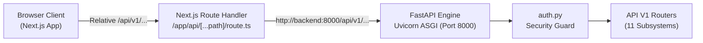
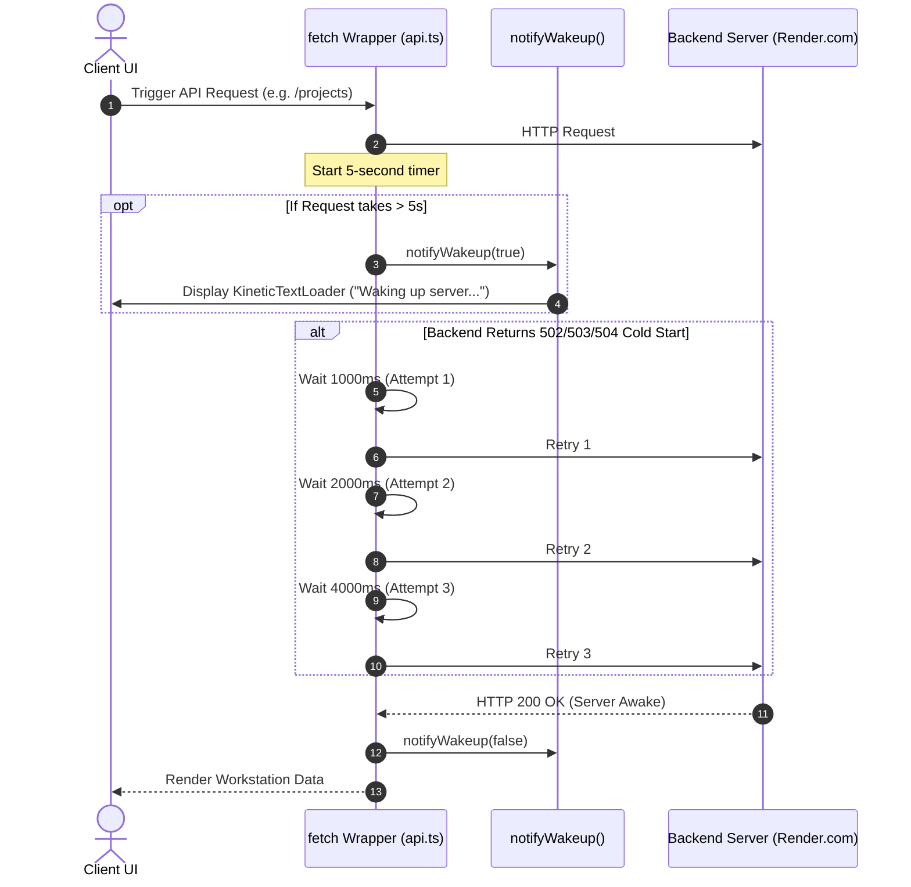

# OptiBuild REST API Specification & Endpoint Reference (API.md)

> **Document Type:** Complete REST API Specification, Schemas & Integration Reference  
> **Repository:** `divyal27/OptiBuild-Main`  
> **Version:** 2.1.0 (Safe Training Data & DPDP Consent Baseline)  
> **Date:** 2026-11-02  
> **Base URL:** `/api/v1` (FastAPI backend mounted at port `8000`, proxied via Next.js `/api/...`)  
> **Status:** Single Source of Truth for Endpoints, Schemas, Authentication Rules, and Error Handling

---

## 1. API Architecture & Global Conventions

### 1.1 Base URL & Routing Architecture
All business logic endpoints are mounted under the prefix `/api/v1` defined in [`backend/app/core/config.py`](file:///d:/OptiBuild%20BE%20Project/OptiBuild-Main/backend/app/core/config.py):
* **Local Backend URL:** `http://localhost:8000/api/v1`
* **Docker Network URL:** `http://backend:8000/api/v1`
* **Client Workstation Proxy:** Browser requests target `/api/v1/...` relative paths, routed through Next.js reverse proxy route handler [`frontend/src/app/api/[...path]/route.ts`](file:///d:/OptiBuild%20BE%20Project/OptiBuild-Main/frontend/src/app/api/[...path]/route.ts) to eliminate CORS restrictions.



### 1.2 Authentication & Token Delivery
Authentication enforces a **dual delivery mechanism**:
1. **HTTP-Only Cookie:** Successful login sets an `access_token` cookie with `HttpOnly=True`, `SameSite=Lax`, and `Max-Age=86400` (24 hours).
2. **Bearer Authorization Header:** Login also returns a JSON payload with `access_token`. Client requests may pass:
   ```http
   Authorization: Bearer <jwt_access_token>
   ```
* **JWT Algorithm:** `HS256` signed using `JWT_SECRET` ($\ge 32\text{ chars}$).
* **Token Claims Payload:**
  ```json
  {
    "sub": "user_uuid_here",
    "email": "pm@optibuild.io",
    "role": "project_manager",
    "name": "Rajesh Sharma (Project Manager)",
    "exp": 1730246400
  }
  ```

### 1.3 Role-Based Access Control (RBAC) Hierarchy
Seven discrete roles are enforced via dependency injection ([`require_roles`](file:///d:/OptiBuild%20BE%20Project/OptiBuild-Main/backend/app/core/auth.py#L123)):
* `admin`: Global superuser; bypasses all role restrictions.
* `project_manager`: Full access to RERA setup, WBS generation, scheduling, delay optimization, and consent settings.
* `site_engineer`: Task progress reporting, site photo uploads, and CV stage inspection.
* `store_keeper`: Inbound material procurement logging and unparsed invoice uploading.
* `architect`: Architectural CAD/PDF blueprint drawing uploads (view-only vault).
* `accountant`: Budget vs. actual spend auditing, invoice variance tracking, and rate recalibration.
* `owner`: Executive KPI monitoring, Section 18 penalty tracking, and S-curve auditing.

### 1.4 Standard Error Response Format
All error responses adhere to standard FastAPI JSON structure:
```json
{
  "detail": "Descriptive error message explaining the failure condition."
}
```

| HTTP Status Code | Classification | Trigger Condition |
|:---|:---|:---|
| `200 OK` | Success | Request succeeded with response body. |
| `201 Created` | Resource Created | Project or certificate successfully persisted. |
| `400 Bad Request` | Client Validation Error | Cyclic task dependencies, missing predecessors, or invalid parameters. |
| `401 Unauthorized` | Authentication Failure | Missing, invalid, or expired JWT token / cookie. |
| `403 Forbidden` | Authorization Failure | User role lacks sufficient permissions or project membership. |
| `404 Not Found` | Resource Missing | Specified `project_id` or `task_id` does not exist in database. |
| `413 Content Too Large` | Storage Quota Exceeded | Uploaded file exceeds size limits (PDF > 10MB, Image > 5MB, DWG > 20MB). |
| `422 Unprocessable Entity`| Schema Validation Error | Pydantic validation failure on request payload fields. |
| `500 Server Error` | Computational Failure | Mathematical engine failure or uncaught runtime exception. |

---

## 2. Interactive Quick-Reference Endpoint Catalog (44 Endpoints)

| # | Subsystem | Method | Endpoint Path | Permitted Roles | Summary |
|:---:|:---|:---:|:---|:---|:---|
| 1 | **Auth** | `POST` | `/api/v1/auth/login` | Public | Authenticates credentials; returns JWT and sets cookie. |
| 2 | | `POST` | `/api/v1/auth/register` | Public | Registers new user, assigns RBAC role, returns JWT and sets cookie. |
| 3 | | `POST` | `/api/v1/auth/logout` | Authenticated | Clears authentication cookie. |
| 4 | | `GET` | `/api/v1/auth/me` | Authenticated | Returns current user profile and assigned projects. |
| 5 | **Users** | `GET` | `/api/v1/users` | `admin`, `pm` | Lists all organization user accounts. |
| 6 | | `POST` | `/api/v1/users` | `admin` | Provisions a new user account with role. |
| 7 | **Projects** | `GET` | `/api/v1/projects` | Authenticated | Lists all visible/assigned projects. |
| 8 | | `GET` | `/api/v1/projects/{project_id}` | Project Member | Returns complete project details, WBS, schedule, and team. |
| 9 | | `POST` | `/api/v1/projects/{project_id}/members` | `pm`, `admin` | Assigns an organization user to project team. |
| 10 | | `POST` | `/api/v1/projects/{project_id}/wbs` | `pm`, `admin` | Generates parametric WBS and persists tasks with floats. |
| 11 | | `POST` | `/api/v1/projects/{project_id}/schedule` | `pm`, `admin` | Runs CPM + GA RCPSP scheduler and persists results. |
| 12 | | `POST` | `/api/v1/projects/{project_id}/optimizer` | `pm`, `admin` | Evaluates delay recovery (penalty vs crash) and saves result. |
| 13 | | `POST` | `/api/v1/projects/{project_id}/benchmark` | `pm`, `admin` | Runs GA vs OR-Tools CP-SAT benchmark on project tasks. |
| 14 | | `PATCH` | `/api/v1/projects/{project_id}/tasks/{task_id}/progress` | `site_engineer`, `pm`, `admin` | Updates progress percentage and status of a schedule task. |
| 15 | | `GET` | `/api/v1/projects/{project_id}/drawings` | Project Member | Lists architectural CAD/PDF drawings for project. |
| 16 | | `POST` | `/api/v1/projects/{project_id}/drawings` | `architect`, `pm`, `admin` | Uploads an attach-only architectural drawing (**INV-2**). |
| 17 | | `GET` | `/api/v1/projects/{project_id}/photos` | Project Member | Lists uploaded site progress photos and CV stage predictions. |
| 18 | | `POST` | `/api/v1/projects/{project_id}/photos` | `site_engineer`, `pm`, `admin` | Uploads site photo, runs classifier heuristics, records result. |
| 19 | **Schedule** | `POST` | `/api/v1/schedule/cpm` | Authenticated | Stateless unconstrained CPM calculation (floats, critical path). |
| 20 | | `POST` | `/api/v1/schedule/optimize` | `pm`, `admin` | Stateless RCPSP Genetic Algorithm scheduler with resource limits. |
| 21 | **Optimizer** | `POST` | `/api/v1/optimizer/evaluate` | `pm`, `admin` | Stateless delay recovery evaluation: Section 18 penalty vs crashing. |
| 22 | **WBS** | `GET` | `/api/v1/wbs/default-ratios` | Authenticated | Returns CPWD standard building category ratio templates. |
| 23 | | `POST` | `/api/v1/wbs/generate` | `pm`, `admin` | Stateless WBS generator from building parameters. |
| 24 | **MahaRERA** | `POST` | `/api/v1/rera/upload-parse` | `pm`, `admin` | Extracts PDF text/tables; returns pre-fill draft (**INV-4**). |
| 25 | | `POST` | `/api/v1/rera/confirm` | `pm`, `admin` | Compulsory confirmation gate; persists confirmed project to DB. |
| 26 | **Materials**| `GET` | `/api/v1/materials/log` | Project Member | Returns procurement entries, category totals, and grand total. |
| 27 | | `POST` | `/api/v1/materials/log` | `store_keeper`, `pm`, `admin` | Logs an itemized material receipt record. |
| 28 | | `POST` | `/api/v1/materials/upload-bill` | `store_keeper`, `pm`, `admin` | Uploads invoice photo as unparsed evidence to S3 (**INV-3**). |
| 29 | | `POST` | `/api/v1/materials/classify-photo` | `site_engineer`, `pm`, `admin` | Stateless CV classification of site photo bytes (**INV-5**). |
| 30 | **Dashboard**| `GET` | `/api/v1/dashboard/budget-vs-actual` | `accountant`, `owner`, `pm`, `admin` | Returns 12-month S-Curve, category variance, and recalibrated costs. |
| 31 | | `POST` | `/api/v1/dashboard/recalibrate-crash-costs` | `accountant`, `pm`, `admin` | Updates critical path crash slopes from live invoice data. |
| 32 | **Benchmark**| `GET` | `/api/v1/benchmark/presets` | Authenticated | Returns construction benchmark presets (Small, Medium, Large). |
| 33 | | `POST` | `/api/v1/benchmark/run` | `pm`, `admin` | Executes side-by-side GA vs Google OR-Tools CP-SAT benchmark. |
| 34 | **Health** | `GET` | `/health` | Public | Service health check returning service status and version. |
| 35 | **Feedback**| `POST` | `/api/v1/feedback` | Public / Auth | Submits bug report or feedback with background Jira dispatch. |
| 36 | | `GET` | `/api/v1/feedback` | `admin`, `pm` | Lists and filters submitted feedback and bug reports. |
| 37 | | `GET` | `/api/v1/feedback/stats` | Authenticated | Aggregated feedback statistics (resolution latency, ratings). |
| 38 | | `GET` | `/api/v1/feedback/{id}` | `admin`, `pm` | Retrieves single feedback report and telemetry payload. |
| 39 | **Training** | `GET` | `/api/v1/projects/{project_id}/consent` | Project Member | Returns project data-sharing consent status and DPDP details. |
| 40 | | `PATCH` | `/api/v1/projects/{project_id}/consent` | `pm`, `admin` | Toggles data-sharing agreement; auto-triggers harvest on opt-in. |
| 41 | | `GET` | `/api/v1/training/overview` | Authenticated | Returns platform-wide consent rates and domain sample counts. |
| 42 | | `POST` | `/api/v1/training/harvest` | `pm`, `admin` | Ingests anonymized training samples from all consented projects. |
| 43 | | `GET` | `/api/v1/training/export` | Authenticated | Exports sanitized training corpus in JSON or JSONL format. |
| 44 | | `POST` | `/api/v1/training/calibrate-engine` | `pm`, `admin` | Calibrates GA scheduler defaults & cost slopes from agreed data. |

---

## 3. Detailed Endpoint Reference (Subsystem by Subsystem)

### 3.1 Authentication & Access Control (`/auth`)
* **Router Source:** [`backend/app/api/v1/auth.py`](file:///d:/OptiBuild%20BE%20Project/OptiBuild-Main/backend/app/api/v1/auth.py)

#### 1. `POST /api/v1/auth/login`
Authenticates a user by email and password, generates an HS256 JWT, sets an HTTP-only browser cookie, and returns the user profile. Supports pre-seeded demo aliases (`site@optibuild.io` $\leftrightarrow$ `engineer@optibuild.io`).
* **Auth Required:** None (Public).
* **Request Body ([`LoginRequest`](file:///d:/OptiBuild%20BE%20Project/OptiBuild-Main/backend/app/schemas/auth.py#L5)):**
  ```json
  {
    "email": "pm@optibuild.io",
    "password": "Pm@123"
  }
  ```
* **Success Response (`200 OK` - [`TokenResponse`](file:///d:/OptiBuild%20BE%20Project/OptiBuild-Main/backend/app/schemas/auth.py#L20)):**
  * Also sets HTTP response header: `Set-Cookie: access_token=...; Path=/; Max-Age=86400; HttpOnly; SameSite=Lax`
  ```json
  {
    "access_token": "eyJhbGciOiJIUzI1NiIsIn...",
    "token_type": "bearer",
    "user": {
      "id": "usr-pm-01",
      "email": "pm@optibuild.io",
      "full_name": "Rajesh Sharma",
      "role": "project_manager"
    }
  }
  ```

---

### 3.12 Safe Data Telemetry & Algorithm Training (`/projects/{id}/consent`, `/training`)
* **Router Source:** [`backend/app/api/v1/training.py`](file:///d:/OptiBuild%20BE%20Project/OptiBuild-Main/backend/app/api/v1/training.py)
* **Compliance Framework:** Digital Personal Data Protection Act (DPDP), 2023. Explicit opt-in consent gate with salted HMAC de-identification. Architectural drawings (INV-2) and bill invoice receipts (INV-3) are strictly excluded from all training corpora.

#### 39. `GET /api/v1/projects/{project_id}/consent`
Returns the current data-sharing consent status, timestamp, and legal notice for a project.
* **Auth Required:** Project Member.
* **Success Response (`200 OK` - `ConsentStatusResponse`):**
  ```json
  {
    "project_id": "emerald-heights-ph2",
    "project_name": "Emerald Heights Phase 2 (Tower A & B)",
    "data_sharing_consent": true,
    "consent_given_at": "2026-11-02T18:00:00Z",
    "consent_by_id": "usr-admin-01",
    "anonymized_telemetry_opt_in": true,
    "legal_framework": "Digital Personal Data Protection Act (DPDP), 2023 Compliant",
    "privacy_guarantee": "Strictly de-identified. Architectural CAD drawings and invoice bill photos are excluded by architectural invariants INV-2 and INV-3."
  }
  ```

#### 40. `PATCH /api/v1/projects/{project_id}/consent`
Updates data-sharing agreement for a project. Triggers automatic anonymized harvest upon opt-in; purges stored samples upon revocation.
* **Auth Required:** `project_manager`, `admin`.
* **Request Body (`ConsentUpdateRequest`):**
  ```json
  {
    "data_sharing_consent": true,
    "anonymized_telemetry_opt_in": true
  }
  ```
* **Success Response (`200 OK` - `ConsentStatusResponse`)**

#### 41. `GET /api/v1/training/overview`
Returns platform-wide governance metrics: total projects, consented project count, consent rate percentage, and available sample counts across 4 domains (`RCPSP_SCHEDULING`, `COST_SLOPES`, `DELAY_RECOVERY`, `CV_CLASSIFIER`).
* **Auth Required:** Authenticated.
* **Success Response (`200 OK` - `TrainingOverviewResponse`):**
  ```json
  {
    "total_projects": 5,
    "consented_projects": 3,
    "consent_rate_percent": 60.0,
    "total_training_samples": 12,
    "domain_breakdown": [
      { "domain": "RCPSP_SCHEDULING", "sample_count": 3, "description": "Topological DAG precedence..." },
      { "domain": "COST_SLOPES", "sample_count": 3, "description": "Empirical material price inflation..." },
      { "domain": "DELAY_RECOVERY", "sample_count": 3, "description": "MahaRERA delay penalties..." },
      { "domain": "CV_CLASSIFIER", "sample_count": 3, "description": "Site photo features mapped to confirmed stages..." }
    ],
    "dpdp_compliance_status": "100% Compliant — Zero unconsented records ingested",
    "last_harvested_at": "2026-11-02T23:30:00Z"
  }
  ```

#### 42. `POST /api/v1/training/harvest`
Harvests sanitized training samples across all projects where `data_sharing_consent == True`.
* **Auth Required:** `project_manager`, `admin`.
* **Success Response (`200 OK` - `HarvestResponse`)**

#### 43. `GET /api/v1/training/export`
Exports clean, de-identified training datasets.
* **Auth Required:** Authenticated.
* **Query Parameters:** `domain` (optional), `format` (`json` or `jsonl`).
* **Success Response (`200 OK`):** JSON array or JSONL stream.

#### 44. `POST /api/v1/training/calibrate-engine`
Calibrates Genetic Algorithm scheduler defaults (population size, generations, mutation rate) and empirical cost slope inflation using strictly consented project data.
* **Auth Required:** `project_manager`, `admin`.
* **Success Response (`200 OK` - `CalibrateEngineResponse`):**
  ```json
  {
    "total_samples_analyzed": 12,
    "recommended_ga_hyperparameters": {
      "population_size": 42,
      "generations": 85,
      "mutation_rate": 0.22,
      "crossover_rate": 0.85,
      "empirical_basis": "Calibrated across 3 consented project DAG networks"
    },
    "empirical_cost_slope_inflation": {
      "steel_rebar_slope_inflation_factor": 1.08,
      "ready_mix_concrete_slope_factor": 1.05,
      "masonry_blocks_slope_factor": 1.02
    },
    "cv_ground_truth_samples": 4,
    "status": "CALIBRATED_SUCCESSFULLY"
  }
  ```

---

## 4. Client Integration, Cold-Start Retries & Error Handling

### 4.1 Automatic Wakeup & 3x Exponential Backoff Retry ([`frontend/src/lib/api.ts`](file:///d:/OptiBuild%20BE%20Project/OptiBuild-Main/frontend/src/lib/api.ts))
When deploying on free-tier cloud instances (e.g. Render.com), backend containers spin down after 15 minutes of inactivity. The client-side fetch interceptor provides built-in resilience:



---

*API specification validated against backend router files in `backend/app/api/v1/` and approved as single source of truth in `API.md`.*
