# OptiBuild Database Specification & Schema Reference (DATABASE.md)

> **Document Type:** Comprehensive Database Architecture, Schema Reference & Migration Guide  
> **Repository:** `divyal27/OptiBuild-Main`  
> **Version:** 2.1.0 (Safe Training Data & DPDP Consent Baseline)  
> **Date:** 2026-11-02  
> **Status:** Single Source of Truth for Relational Schema, Models, Relationships, and Data Management  
> **Rule:** Documented strictly from actual codebase. **Zero schema alterations.**

---

## 1. Database Architecture & Engine Configuration

### 1.1 Dual Engine Strategy (PostgreSQL & SQLite)
OptiBuild utilizes a dual-engine architecture to ensure production performance while maintaining local development flexibility:

```mermaid
flowchart TD
    ENV["DATABASE_URL Environment Variable"] --> PARSE["clean_database_url() in session.py"]
    PARSE --> CHECK{"Engine Protocol"}
    
    CHECK -->|"postgresql://" or "postgres://"| PG["Production: PostgreSQL 16<br/>psycopg2-binary Driver<br/>poolclass: NullPool"]
    CHECK -->|"sqlite:///" or Unset Fallback| SQLITE["Development Fallback: SQLite 3<br/>File: optibuild.db<br/>connect_args: check_same_thread: False"]

    PG --> SUPA["Supabase / Transaction Pooler (Port 6543)<br/>Stripped '?pgbouncer=true'"]
    SQLITE --> LOCAL["Zero-Config Offline Demo<br/>Single-File Portability"]
```

1. **Production Engine (PostgreSQL 16):**
   * Primary deployment target (`postgres:16-alpine`).
   * Supports JSON/JSONB data structures, foreign key constraints with cascade deletes, and relational joins.
   * Compatible with Supabase Transaction Pooler (port `6543`).
2. **Resilient Local Fallback (SQLite 3):**
   * When `DATABASE_URL` is unset or PostgreSQL is unreachable, the system automatically falls back to `sqlite:///./optibuild.db`.
   * Configured with `connect_args={"check_same_thread": False}` for multi-threaded FastAPI execution.

### 1.2 Connection Pooling & Normalization ([`backend/app/db/session.py`](file:///d:/OptiBuild%20BE%20Project/OptiBuild-Main/backend/app/db/session.py))
* **Neon Serverless PostgreSQL Support:** OptiBuild supports Neon serverless Postgres (`ep-*.neon.tech`), including direct SSL encrypted links and Neon connection poolers.
* **URL Normalization:** The [`clean_database_url()`](file:///d:/OptiBuild%20BE%20Project/OptiBuild-Main/backend/app/db/session.py) function sanitizes connection strings:
  * Strips `?pgbouncer=true` or `&pgbouncer=true` to prevent driver connection errors.
  * Normalizes legacy `postgres://` prefixes to `postgresql+psycopg2://` as required by SQLAlchemy 2.0.
  * Preserves `sslmode=require` query parameters required by Neon PostgreSQL.
* **NullPool & Pre-Ping Configuration:** External connection poolers (Neon, PgBouncer, Supabase) maintain their own server-side connection pools. OptiBuild configures `poolclass=NullPool` with `pool_pre_ping=True` for PostgreSQL to avoid connection drops during serverless inactivity and auto-reconnect:
  ```python
  if not url.startswith("sqlite"):
      kwargs["poolclass"] = NullPool
      kwargs["pool_pre_ping"] = True
  else:
      kwargs["connect_args"] = {"check_same_thread": False}
  ```

---

## 2. Global Entity-Relationship Diagram (11 Entities)

```mermaid
erDiagram
    ORGANIZATIONS ||--o{ PROJECTS : owns
    ORGANIZATIONS ||--o{ USERS : employs
    USERS ||--o{ PROJECT_MEMBERS : assigned_to
    PROJECTS ||--o{ PROJECT_MEMBERS : includes
    PROJECTS ||--o{ TASKS : schedules
    PROJECTS ||--o{ MATERIAL_LOGS : audits
    PROJECTS ||--o{ PROJECT_DRAWINGS : archives
    PROJECTS ||--o{ RERA_CERTIFICATES : confirms
    PROJECTS ||--o{ SITE_PHOTOS : records
    PROJECTS ||--o{ DELAY_RECOVERY_EVALUATIONS : logs
    PROJECTS ||--o{ FEEDBACK_REPORTS : tracks
    PROJECTS ||--o{ TRAINING_DATA_SAMPLES : trains

    ORGANIZATIONS {
        string id PK "UUID (String 50, Indexed)"
        string name "Organization Name"
        datetime created_at "UTC Timestamp"
    }

    USERS {
        string id PK "UUID (String 50, Indexed)"
        string email UK "Unique Email (Indexed)"
        string hashed_password "bcrypt blowfish hash"
        string full_name "Display Name"
        string role "admin|project_manager|site_engineer|store_keeper|architect|accountant|owner"
        boolean is_active "Active user flag"
        datetime created_at "UTC Timestamp"
    }

    PROJECTS {
        string id PK "UUID (String 50, Indexed)"
        string organization_id FK "organizations.id"
        string name "Project Title"
        string status "ACTIVE|COMPLETED|ON_HOLD"
        string rera_registration_no "P5XXXXXXXXXX (Indexed)"
        string promoter_name "Promoter / Developer Entity"
        string proposed_completion_date "YYYY-MM-DD"
        float plot_area_sqft "Plot Area (sq.ft.)"
        float built_up_area_sqft "Built-up Area (sq.ft.)"
        float carpet_area_sqft "Carpet Area (sq.ft.)"
        int number_of_floors "Floors count"
        int number_of_basements "Basement levels"
        float base_rate_per_sqft "CPWD Base Rate (INR)"
        float total_project_cost "Total Cost (INR)"
        float total_allottee_investment "Allottee Escrow Pool (INR)"
        float sbi_mclr_rate "SBI MCLR Rate (8.85% = 0.0885)"
        float rera_spread "RERA Spread (2.0% = 0.02)"
        int delay_days "Contractual Delay in Days"
        json wbs_data "Parametric WBS JSON snapshot"
        json schedule_data "CPM & GA Schedule JSON snapshot"
        json optimizer_data "Crashing trade-off JSON snapshot"
        json benchmark_data "GA vs CP-SAT comparison snapshot"
        boolean data_sharing_consent "DPDP Act 2023 Opt-In Consent"
        datetime consent_given_at "Consent Granted Timestamp"
        string consent_by_id FK "users.id (Consent Granter)"
        boolean anonymized_telemetry_opt_in "Solver Telemetry Opt-In"
        string created_by_id FK "users.id"
        datetime created_at "UTC Timestamp"
        datetime updated_at "UTC Timestamp"
    }

    PROJECT_MEMBERS {
        string id PK "UUID (String 50)"
        string project_id FK "projects.id (CASCADE, Indexed)"
        string user_id FK "users.id (CASCADE, Indexed)"
        string role "Project Role Override"
        datetime created_at "UTC Timestamp"
    }

    TASKS {
        string id PK "Activity ID, e.g. T01 (Indexed)"
        string project_id FK "projects.id (CASCADE, Indexed)"
        string name "Task Activity Title"
        int duration "Normal Duration (Days)"
        float normal_cost "Normal Cost (INR)"
        float crash_cost "Crash Cost (INR)"
        int crash_duration "Minimum Duration (Days)"
        json predecessors "Dependency Task IDs ['T01']"
        json resource_demands "Daily resources {'labor': 10}"
        boolean is_critical "CPM Critical Path flag"
        int total_float "CPM Total Float (Days)"
        int free_float "CPM Free Float (Days)"
        float progress_percent "0.0 to 100.0"
        string status "NOT_STARTED|IN_PROGRESS|COMPLETED"
        string actual_start "YYYY-MM-DD"
        string actual_finish "YYYY-MM-DD"
        datetime created_at "UTC Timestamp"
    }

    MATERIAL_LOGS {
        string entry_id PK "UUID (String 50, Indexed)"
        string project_id FK "projects.id (CASCADE, Indexed)"
        string date "Delivery Date (YYYY-MM-DD)"
        string material_category "Steel|RMC|Cement|Sand|Bricks"
        text item_description "Procurement details"
        string wbs_code "WBS Code (e.g. WBS-1.1)"
        float quantity "Delivered Quantity"
        string unit "MT|Cu.m|Bags|Brass"
        float unit_rate "Unit Price (INR)"
        float total_amount "Total Invoice Cost (INR)"
        string supplier_name "Vendor / Supplier Name"
        string invoice_no "Challan / Invoice Number"
        text bill_attachment_url "Unparsed S3 URL (INV-3)"
        string logged_by_id FK "users.id"
        datetime created_at "UTC Timestamp"
    }

    PROJECT_DRAWINGS {
        string id PK "UUID (String 50)"
        string project_id FK "projects.id (CASCADE, Indexed)"
        string title "Drawing Sheet Title"
        string drawing_type "ARCHITECTURAL|STRUCTURAL|MEP"
        string file_name "Sanitized filename"
        text file_url "Unparsed S3 URL (INV-2)"
        string uploaded_by_id FK "users.id"
        datetime uploaded_at "UTC Timestamp"
    }

    RERA_CERTIFICATES {
        string id PK "UUID (String 50, Indexed)"
        string project_id FK "projects.id (CASCADE, Indexed)"
        string rera_registration_no "P5XXXXXXXXXX (Indexed)"
        string project_name "Sanctioned Project Name"
        string promoter_name "Promoter / Developer Name"
        string proposed_completion_date "YYYY-MM-DD"
        float plot_area_sqft "Plot area"
        float built_up_area_sqft "Built-up area"
        float carpet_area_sqft "Carpet area"
        int number_of_floors "Sanctioned floors"
        int number_of_basements "Sanctioned basements"
        float total_project_cost "Estimated cost"
        string status "CONFIRMED"
        text raw_pdf_url "S3 raw certificate URL"
        datetime confirmed_at "UTC Timestamp"
    }

    SITE_PHOTOS {
        string id PK "UUID (String 50, Indexed)"
        string project_id FK "projects.id (CASCADE)"
        text photo_url "S3 photo URL"
        string predicted_stage "STRUCTURAL_STAGE|FINISHING_STAGE"
        string stage_label "Readable stage title"
        float confidence_score "CV Confidence (0.0 to 1.0)"
        json detected_features "List of detected traits"
        text notes "Field inspection notes"
        string engineer_confirmed_stage "Manual engineer override"
        string uploaded_by_id FK "users.id"
        datetime uploaded_at "UTC Timestamp"
    }

    DELAY_RECOVERY_EVALUATIONS {
        string id PK "UUID (String 50, Indexed)"
        string project_id FK "projects.id (CASCADE)"
        int delay_days "Days delayed past RERA"
        float rera_daily_penalty "Daily Section 18 penalty"
        float rera_total_penalty "Option A total penalty"
        float total_crash_cost "Option B total crashing cost"
        int days_recovered "Total schedule days compressed"
        float net_savings "Option A - Option B savings"
        string recommendation "CRASH|ACCEPT_PENALTY"
        json crashing_actions "Itemized compressed activities"
        datetime evaluated_at "UTC Timestamp"
    }

    FEEDBACK_REPORTS {
        string id PK "UUID (String 50, Indexed)"
        string report_type "BUG|FEEDBACK|FEATURE_REQUEST (Indexed)"
        string title "Concise issue summary or title"
        text description "Detailed reproduction or feedback"
        string category "Subsystem category (Indexed)"
        string severity "LOW|MEDIUM|HIGH|CRITICAL"
        int rating "1 to 5 user rating (Nullable)"
        string status "OPEN|TRIAGED|IN_PROGRESS|RESOLVED|CLOSED (Indexed)"
        json telemetry_data "Auto-collected client runtime state"
        text attachment_url "Unparsed screenshot evidence (INV-3)"
        string jira_issue_key "Linked Jira issue key (Indexed, Nullable)"
        string submitted_by_id FK "users.id (Nullable)"
        string project_id FK "projects.id ON DELETE CASCADE (Nullable)"
        text admin_notes "Admin resolution notes (Nullable)"
        datetime created_at "UTC Timestamp"
        datetime updated_at "UTC Timestamp"
    }

    TRAINING_DATA_SAMPLES {
        string id PK "UUID (String 50, Indexed)"
        string project_id FK "projects.id ON DELETE CASCADE (Indexed)"
        string domain "RCPSP_SCHEDULING|COST_SLOPES|DELAY_RECOVERY|CV_CLASSIFIER (Indexed)"
        string anonymized_project_hash "Salted HMAC-SHA256 Hash (Indexed)"
        json features "Sanitized input graph & cost features"
        json target_metrics "Makespan, inflation & confirmed stage ground-truth"
        string source_version "Dataset schema version"
        datetime created_at "UTC Timestamp"
    }
```



---

## 3. Comprehensive Table Schemas (All 12 Tables)

### 3.1 `organizations` Table
* **Model Class:** [`Organization`](file:///d:/OptiBuild%20BE%20Project/OptiBuild-Main/backend/app/db/models.py#L22)
* **Purpose:** Multi-tenant root organization entity for enterprise isolation.

| Column Name | Data Type | Nullable | Default | Constraints & Indexes | Description |
|:---|:---|:---:|:---:|:---:|:---|
| `id` | `VARCHAR(50)` | No | `uuid4()` | Primary Key | Unique organization identifier. |
| `name` | `VARCHAR(255)` | No | — | — | Registered enterprise name (e.g. "OptiBuild Infrastructure Corp"). |
| `created_at` | `DATETIME` | Yes | `utcnow()` | — | Organization provisioning timestamp. |

* **ORM Relationships:**
  * `projects`: `relationship("Project", back_populates="organization")`

---

### 3.2 `users` Table
* **Model Class:** [`User`](file:///d:/OptiBuild%20BE%20Project/OptiBuild-Main/backend/app/db/models.py#L32)
* **Purpose:** Authentication and RBAC profile table.

| Column Name | Data Type | Nullable | Default | Constraints & Indexes | Description |
|:---|:---|:---:|:---:|:---:|:---|
| `id` | `VARCHAR(50)` | No | `uuid4()` | Primary Key | Unique user account identifier. |
| `email` | `VARCHAR(255)` | No | — | Unique, Index | User login email. |
| `hashed_password` | `VARCHAR(255)` | No | — | — | bcrypt hash of user password. |
| `full_name` | `VARCHAR(255)` | No | — | — | User full display name. |
| `role` | `VARCHAR(50)` | No | `'site_engineer'` | — | Primary RBAC role (1 of 7 roles). |
| `is_active` | `BOOLEAN` | Yes | `True` | — | Account active status. |
| `created_at` | `DATETIME` | Yes | `utcnow()` | — | Account creation timestamp. |

* **ORM Relationships:**
  * `project_memberships`: `relationship("ProjectMember", back_populates="user", cascade="all, delete-orphan")`

---

### 3.3 `projects` Table
* **Model Class:** [`Project`](file:///d:/OptiBuild%20BE%20Project/OptiBuild-Main/backend/app/db/models.py#L46)
* **Purpose:** Central entity storing physical building dimensions, financial escrow totals, and computational snapshots.

| Column Name | Data Type | Nullable | Default | Constraints & Indexes | Description |
|:---|:---|:---:|:---:|:---:|:---|
| `id` | `VARCHAR(50)` | No | `uuid4()` | Primary Key, Index | Unique project identifier. |
| `organization_id` | `VARCHAR(50)` | Yes | — | FK $\rightarrow$ `organizations.id` | Owning tenant organization. |
| `name` | `VARCHAR(255)` | No | — | — | Human-readable project title. |
| `status` | `VARCHAR(50)` | Yes | `'ACTIVE'` | — | Operational status (`ACTIVE`, `IN_PROGRESS`, `COMPLETED`, `ON_HOLD`). |
| `rera_registration_no` | `VARCHAR(100)` | Yes | — | Index | Statutory MahaRERA registration number (e.g. `P52100018921`). |
| `promoter_name` | `VARCHAR(255)` | Yes | — | — | Name of developer entity registered on RERA. |
| `proposed_completion_date` | `VARCHAR(50)` | Yes | — | — | Promised handover deadline date (`YYYY-MM-DD`). |
| `plot_area_sqft` | `FLOAT` | Yes | `0.0` | — | Total sanctioned plot area in square feet. |
| `built_up_area_sqft` | `FLOAT` | Yes | `0.0` | — | Gross built-up area used for parametric WBS scaling. |
| `carpet_area_sqft` | `FLOAT` | Yes | `0.0` | — | Net usable residential/commercial carpet area. |
| `number_of_floors` | `INTEGER` | Yes | `0` | — | Number of above-ground RCC floors. |
| `number_of_basements` | `INTEGER` | Yes | `0` | — | Number of underground basement levels. |
| `base_rate_per_sqft` | `FLOAT` | Yes | `2400.0` | — | Baseline construction cost rate in ₹/sq.ft. |
| `total_project_cost` | `FLOAT` | Yes | `0.0` | — | Total sanctioned project expenditure in INR. |
| `total_allottee_investment`| `FLOAT` | Yes | `0.0` | — | Cumulative buyer collections exposed to Section 18 delay interest. |
| `sbi_mclr_rate` | `FLOAT` | Yes | `0.0885` | — | State Bank of India Highest MCLR rate ($8.85\%$). |
| `rera_spread` | `FLOAT` | Yes | `0.02` | — | Statutory premium spread mandated by RERA rules ($2.0\%$). |
| `delay_days` | `INTEGER` | Yes | `0` | — | Current delay in calendar days past proposed completion date. |
| `wbs_data` | `JSON` | Yes | — | — | Pre-computed parametric WBS package and task breakdown snapshot. |
| `schedule_data` | `JSON` | Yes | — | — | Pre-computed Genetic Algorithm RCPSP schedule and timeline snapshot. |
| `optimizer_data` | `JSON` | Yes | — | — | Pre-computed delay recovery crashing trade-off snapshot. |
| `benchmark_data` | `JSON` | Yes | — | — | Pre-computed GA vs OR-Tools CP-SAT comparison snapshot. |
| `data_sharing_consent` | `BOOLEAN` | No | `False` | — | Explicit DPDP Act 2023 opt-in agreement to contribute anonymized graph & cost telemetry. |
| `consent_given_at` | `DATETIME` | Yes | — | — | Timestamp when consent was explicitly recorded. |
| `consent_by_id` | `VARCHAR(50)` | Yes | — | FK $\rightarrow$ `users.id` | User identity who recorded the consent. |
| `anonymized_telemetry_opt_in` | `BOOLEAN` | No | `False` | — | Solver iteration runtime and heuristic telemetry opt-in. |
| `created_by_id` | `VARCHAR(50)` | Yes | — | FK $\rightarrow$ `users.id` | User who registered the project. |
| `created_at` | `DATETIME` | Yes | `utcnow()` | — | Registration timestamp. |
| `updated_at` | `DATETIME` | Yes | `utcnow()` | On Update `utcnow()` | Last modification timestamp. |

* **ORM Relationships:**
  * `organization`: `relationship("Organization", back_populates="projects")`
  * `members`: `relationship("ProjectMember", back_populates="project", cascade="all, delete-orphan")`
  * `tasks`: `relationship("TaskModel", back_populates="project", cascade="all, delete-orphan")`
  * `materials`: `relationship("MaterialLogModel", back_populates="project", cascade="all, delete-orphan")`
  * `drawings`: `relationship("ProjectDrawing", back_populates="project", cascade="all, delete-orphan")`
  * `site_photos`: `relationship("SitePhotoModel", back_populates="project", cascade="all, delete-orphan")`
  * `feedback_reports`: `relationship("FeedbackReportModel", back_populates="project", cascade="all, delete-orphan")`
  * `training_samples`: `relationship("TrainingDataSample", back_populates="project", cascade="all, delete-orphan")`

---

### 3.12 `training_data_samples` Table
* **Model Class:** [`TrainingDataSample`](file:///d:/OptiBuild%20BE%20Project/OptiBuild-Main/backend/app/db/models.py)
* **Purpose:** Stores sanitized, anonymized training records extracted from projects with explicit user data-sharing consent (`data_sharing_consent == True`). Strips all PII, developer identities, CAD drawings, and bill photos.

| Column Name | Data Type | Nullable | Default | Constraints & Indexes | Description |
|:---|:---|:---:|:---:|:---:|:---|
| `id` | `VARCHAR(50)` | No | `uuid4()` | Primary Key | Unique training sample identifier. |
| `project_id` | `VARCHAR(50)` | No | — | FK $\rightarrow$ `projects.id`, Index | Originating project foreign key (`ondelete="CASCADE"`). |
| `domain` | `VARCHAR(50)` | No | — | Index | Target domain: `RCPSP_SCHEDULING`, `COST_SLOPES`, `DELAY_RECOVERY`, `CV_CLASSIFIER`. |
| `anonymized_project_hash` | `VARCHAR(64)` | No | — | Index | Salted HMAC-SHA256 de-identified project fingerprint. |
| `features` | `JSON` | No | — | — | Sanitized input features (DAG density, float ratios, floor counts, color histograms). |
| `target_metrics` | `JSON` | No | — | — | Empirical ground-truth targets (GA makespan, unit rate inflation, confirmed stage). |
| `source_version` | `VARCHAR(20)` | Yes | `'1.0.0'` | — | Dataset schema version. |
| `created_at` | `DATETIME` | Yes | `utcnow()` | — | Ingestion timestamp. |

* **ORM Relationships:**
  * `project`: `relationship("Project", back_populates="training_samples")`

---

*Database specification verified against `backend/app/db/models.py` and approved as single source of truth in `DATABASE.md`.*
